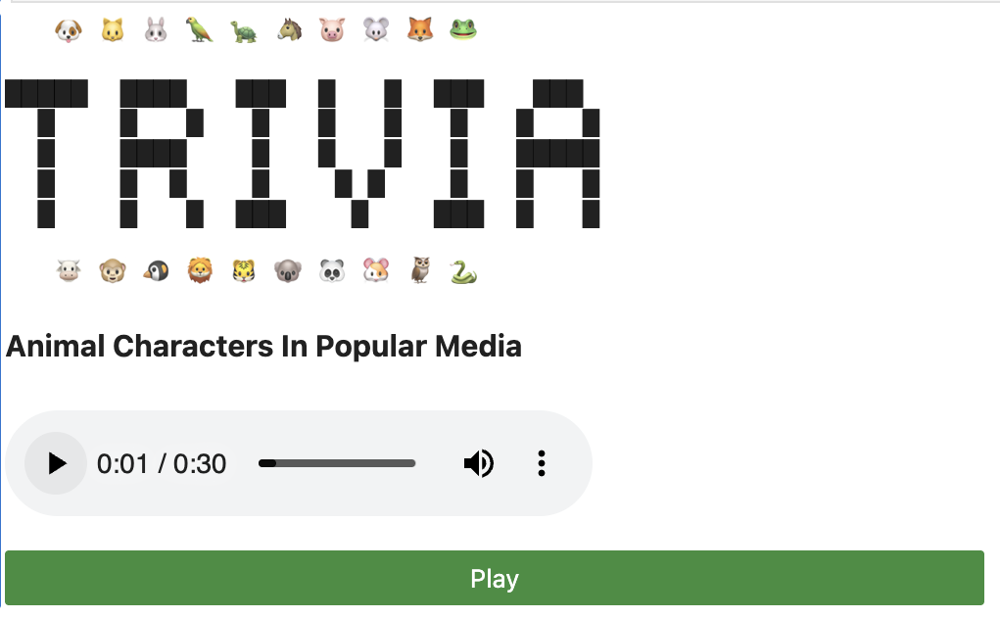

Welcome to the Animals In TV Shows trivia game!

**How to play:**

- After downloading the project folder, run the game by running the main code block.
- The game will take a few seconds to load in order to generate the title music (a new song every time!)
- Press the green Play icon to begin.
- While in game:
  - You can turn off the Jeopardy music by clicking the "Trivia music:on" button at the top of the UI
  - Wrong answers will not give a point, only correct answers on first try.
  - If you need a hint, click the "Hint" button and Google Lyria will generate a song about the character to give you some context clues as to what species it is or what show it might be from.
  - If you want to restart, just click the "Start over" button and your score will reset to 0.
  - 

**Features**:

- Database of 43 shows containing animal characters
- Two current game types:
  - "What species is the animal ____ from the show ____?"
  - "Which animal from this list is a (species)?"
- Score counter and reset
- Fun lil custom ASCII title screen (heh)
